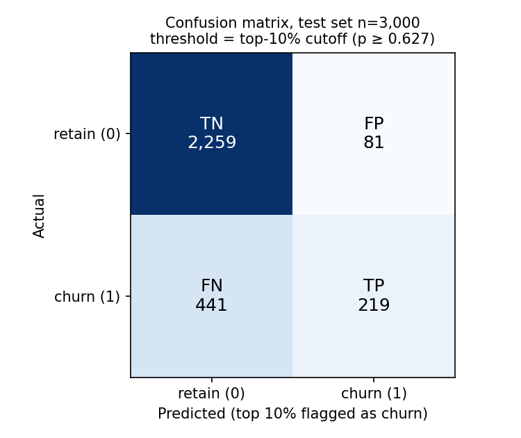
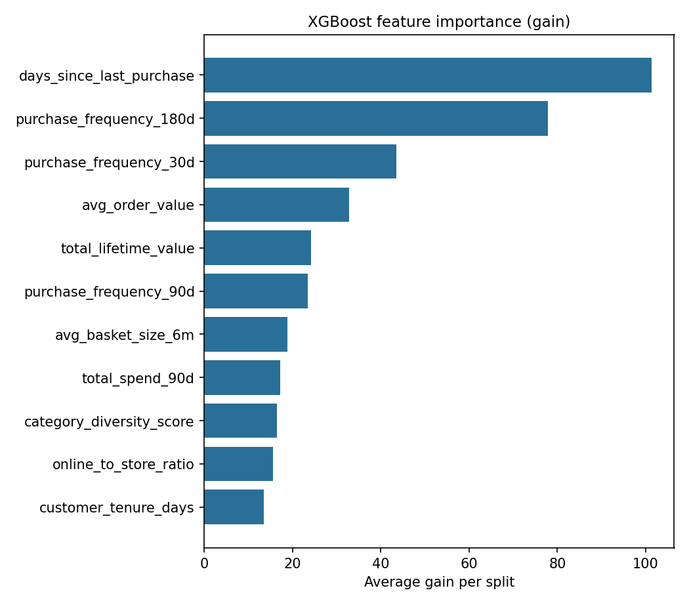

## Lab 3 Churn Model Evaluation Report

### Results

The graded run is `final-full11-d3-eta0.03`. I trained it locally on XGBoost 3.2.0, using data pulled from the Feature Store offline store through Athena. The test set is 3,000 customers (a stratified 30% of 9,999, `random_state=42`), and 22.0% of them churned.

| Metric | Value | Threshold | Status |
|---|---|---|---|
| AUC-ROC (test set) | 0.7827 | report only | - |
| Precision @ top 10% | 0.7300 | ≥ 0.50 | Pass |
| Recall @ top 10% | 0.3318 | ≥ 0.25 | Pass |
| Recency-only baseline AUC | 0.7223 | - | - |
| AUC lift over baseline | +0.0605, 95% CI [0.0422, 0.0778] | CI excludes zero | Pass |

The top 10% is 300 customers, and 219 of them churned. There are 660 churners in the test set, so the best possible recall at 10% is 300 / 660 = 0.455.

The numbers are recorded in four places, and `collect_lab3_evidence.py` checks that they match:

- Athena query `7fa05bef-6ed7-4734-84ca-96dc057313b4` (in `train-final.log`)
- MLflow run `069843e6a19e452785e705f980bfaf58` in experiment `northstar-churn`
- Model Registry `northstar-churn-models` v2, PendingManualApproval
- `lab3-evidence/evaluation_metrics.json`

Registry v1 came from an older version of my training script. I marked it Rejected.

The lab's reference model got 0.7696 full and 0.7233 baseline. My run with the same settings (`full11-d6-eta0.1`) got 0.7764 and 0.7223. I rebuilt the Lab 2 data for this lab, which is probably why they are slightly different, but I did not track down the exact cause.

### Baseline comparison

The baseline is an XGBoost model using only `days_since_last_purchase`, with the same training rows, test rows and `scale_pos_weight` as the full model. I got the CI with a paired bootstrap: 2,000 resamples of the test set, scoring both models on the same resampled rows each time. The interval is well above zero, so the Lab 2 features do more than recency alone.

### Experiments

I ran five experiments, each testing one idea. `scripts/run-lab3-experiments.sh` reruns them, and `scripts/compare_lab3_runs.py` puts a paired bootstrap CI on each run's difference from the first run. If that CI includes zero, I treated the difference as noise.

| Run | What changed | AUC | P@10% | R@10% | Change vs first run [95% CI] |
|---|---|---|---|---|---|
| `full11-d6-eta0.1` | skeleton defaults, 11 features | 0.7764 | 0.7033 | 0.3197 | - |
| `full11-d3-eta0.03` | max_depth 3, eta 0.03 | 0.7827 | 0.7300 | 0.3318 | +0.0063 [-0.0011, +0.0137] |
| `full11-plus-riskscore` | added `churn_risk_score` | 0.7805 | 0.7200 | 0.3273 | +0.0041 [-0.0023, +0.0106] |
| `no-monetary` | removed the 3 spend features | 0.7459 | 0.7100 | 0.3227 | -0.0306 [-0.0462, -0.0151] |
| `pruned-7` | removed tenure, basket size, online ratio, category diversity | 0.7712 | 0.6933 | 0.3152 | -0.0053 [-0.0147, +0.0043] |

What I learned:

- Shallower trees: the first run stopped improving at iteration 10, which looked like overfitting, so I tried depth 3 with a lower learning rate. The AUC gain was within noise, but it had the best precision and recall and was easier to explain, so I used it as the graded model.
- `churn_risk_score`: it has a Spearman correlation of +1.00 with recency, so it is basically the same feature. Adding it did not help, and it took over the feature importance chart, which would make the model look like it depends on the risk score. I left it out of the graded model. The results with and without it are both in the table.
- Spend features: removing them was the only significant drop. Among customers who were still buying near T, churners had a lower average order ($106 vs $153) and lower lifetime value ($1.8k vs $3.2k). I expected recall@10% to drop too, but it did not. The top 10% is mostly customers who stopped buying a long time ago, and recency finds those on its own.
- The four weakest features did not make a measurable difference. I kept them because they are already in the Feature Store.

### Confusion matrix

I used the top 10% cutoff (p ≥ 0.627) instead of 0.5, because the retention team contacts the top 10%. At that cutoff there are 219 true positives, 81 false positives, 441 false negatives and 2,259 true negatives. So 73% of the people contacted actually churn.

### Feature importance

Recency has the most gain (101), then `purchase_frequency_180d` (78) and `purchase_frequency_30d` (44). Gain can be misleading here. `total_spend_90d` ranks low on its own, but removing the three spend features together cost 0.031 AUC. They are correlated with each other, so they split the credit.

### Slice evaluation by loyalty tier

Recall is measured at the overall top 10% cutoff, since there is one contact list. The full output is in `lab3-evidence/slice-evaluation.csv`.

| Tier | Test n | Churners | AUC [95% CI] | Recall @ top 10% | Too small? |
|---|---|---|---|---|---|
| Bronze | 1,071 | 361 | 0.757 [0.724, 0.788] | 0.471 | No |
| Silver | 1,139 | 226 | 0.715 [0.678, 0.755] | 0.181 | No |
| Gold | 483 | 52 | 0.751 [0.681, 0.818] | 0.115 | No |
| Platinum | 307 | 21 | 0.892 [0.820, 0.949] | 0.095 | Yes |

I counted a tier as too small if it had fewer than 30 churners in the test set.

Silver is the weakest tier by AUC. It has enough churners to make that claim, although its CI overlaps with Bronze and Gold. Silver is the middle spend group, where a lot of the still-buying churners are. Its AUC dropped from 0.698 to 0.653 when I removed the spend features, so it depends on them the most. A feature for falling order value over time would probably help.

Gold and Platinum have low recall because high-value customers churn less, so they rarely make the overall top 10%. Only 1.2% of Gold and 1.3% of Platinum customers get flagged. The model still ranks them well within their own tier, so this is more of a business decision. NorthStar could rank by churn probability times lifetime value, or give each tier its own budget.

Platinum is too small to conclude anything. It only has 21 churners in the test set, and its recall of 0.095 is just 2 customers.

### Class imbalance

`scale_pos_weight` is 3.5448. It is calculated from the training split as negatives / positives (5,459 / 1,540), not hardcoded, and it matches the reference value of 3.545. It gives the churners the same total weight as the non-churners in training. One side effect is that the outputs are not real probabilities. The top 10% cutoff is p = 0.627, but 73% of that group actually churned. The Track B prompt treats the score as a ranking for this reason.

### Missing values

I used the skeleton's -1 fill value. It never actually triggers, because the Lab 2 checks make sure there are no nulls. If one did show up, -1 is safe because every feature is zero or positive.

### Limitations

- Early stopping uses the test set, because that is how the skeleton is set up. That could make the metrics slightly optimistic. A separate validation split would fix it.
- All results come from one random split.
- I trained on XGBoost 3.2.0, but the registry lists the SageMaker 1.7 serving image. I have not tested loading the model in that container.
